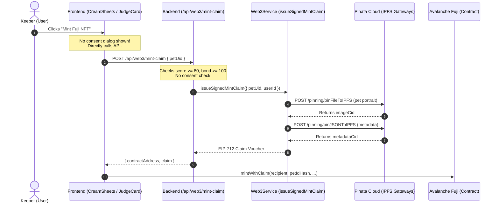
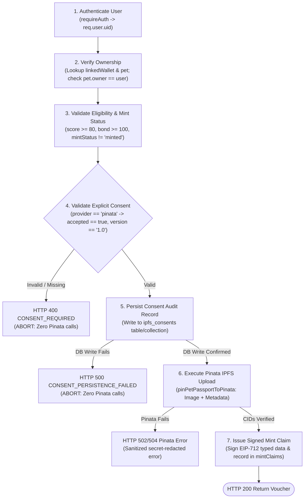

# Public IPFS Consent Architecture & Security Audit

**Document:** Finalized Architecture Design & Security Audit  
**Target:** Explicit User-Consent Flow for Public IPFS Publication  
**Author:** Member 03 (Web3 Infrastructure & Smart Contracts)  
**Status:** Audit & Final Implementation Plan (Codebase Unmodified)  
**Date:** 2026-11-19  

---

## 1. Executive Summary

As demonstrated during the Avalanche Fuji Token #1 audit and Pinata hardening, publishing Pet Passport metadata and portraits to decentralized InterPlanetary File System (IPFS) nodes is permanent, globally replicated, and irreversible. Once content is distributed to IPFS gateways, it cannot be unilaterally deleted, presenting serious legal, compliance, and privacy issues (e.g., GDPR Right to be Forgotten for user-uploaded pet photographs).

Currently, neither the frontend (`CreamSheets.tsx`, `JudgeCardScreen.tsx`) nor the backend API (`/api/web3/mint-claim`) requires or validates explicit user consent. Clicking "Mint Fuji NFT" directly initiates claim voucher creation, which in Pinata IPFS Mode A immediately pins the image and metadata publicly.

This finalized document specifies the **Server-Authoritative Public IPFS Consent Architecture**, establishing strict cryptographic trust boundaries, a unified reusable frontend consent gate (`PublicIpfsConsentModal.tsx`), a 7-step fail-closed backend ordering pipeline, an audited dedicated persistence entity (`ipfs_consents`), and an exhaustive 10-scenario security test matrix.

---

## 2. Current Flow & Trust Boundaries

### 2.1 Current Workflow (Vulnerable to Non-Consensual Publication)



### 2.2 Trust Boundary Audit & Vulnerabilities
1. **Implicit Consent Fallacy:** The current system falsely assumes that reaching Score 80+ and clicking a button labeled "Mint Fuji NFT" constitutes informed consent for permanent public decentralized storage.
2. **Direct API Replay Vulnerability:** An authenticated user or script can execute `curl -X POST /api/web3/mint-claim -d '{"petUid":"..."}'` bypassing any frontend modal entirely. The backend would proceed directly to Pinata upload without verified consent.
3. **Client-Side Spoofing Risk:** If the backend accepts client-supplied timestamps, wallet addresses, or disclosure lists, an adversary could forge consent evidence or inject manipulated audit logs.

---

## 3. Server-Authoritative Consent Model

To guarantee tamper-proof legal and regulatory compliance, the backend is established as the **sole authority** of consent truth:

### 3.1 Authority Division
| Property | Client (Frontend) Role | Server (Backend) Role | Security Rationale |
| :--- | :--- | :--- | :--- |
| **Affirmative Acceptance** | Sends `accepted: true` | Validates `accepted === true` | User must perform affirmative action. |
| **Consent Version** | Sends `consentVersion: "1.0"` | Validates against server dictionary | Prevents client from inventing arbitrary disclosure terms. |
| **Timestamp (`consentedAt`)** | Ignored if sent | **Generated using server clock (`Date.now()`)** | Eliminates clock skew, timezone manipulation, and forged past/future timestamps. |
| **Disclosures List** | Ignored if sent | **Derived from authoritative server dictionary** | Client cannot cherry-pick or omit mandatory legal disclosures. |
| **Wallet Identity** | Ignored if sent | **Derived from verified database linked wallet** | Client cannot forge consent on behalf of a third-party wallet. |
| **User Identity** | Ignored if sent | **Derived from authenticated session (`req.user.uid`)** | Eliminates ID spoofing. |

### 3.2 Server-Authoritative Disclosure Dictionary
```ts
export const IPFS_DISCLOSURE_VERSIONS: Record<string, { version: string; disclosures: string[] }> = {
  '1.0': {
    version: '1.0',
    disclosures: [
      'public_ipfs_storage',       // Portrait uploaded to public decentralized IPFS
      'public_nft_metadata',       // Metadata and scores publicly readable on-chain
      'decentralized_permanence',  // Content persists indefinitely on peer-to-peer nodes
      'no_deletion_guarantee',     // App cannot guarantee erasure from decentralized DHT
    ],
  },
};
```

---

## 4. Audit Persistence Review: `pets.memories` vs Dedicated Audit Store

### 4.1 Detailed Code Inspection of `pets.memories`
During the audit, the complete lifecycle of `memories` was inspected across both PostgreSQL and Cloud Firestore implementations:

1. **PostgreSQL Rolling Buffer Truncation:**
   - In `src/server/gameActions.ts` (Lines 682, 707):
     ```ts
     const updatedMemories = [
       newMemory,
       ...(pet.memories || []).slice(-19), // Explicit cap at 20 items!
     ];
     await tx.update(pets).set({ memories: updatedMemories }).where(eq(pets.id, pet.id));
     ```
   - In `src/server/gameActions.ts` (Lines 863, 893) and (Lines 1047, 1064):
     ```ts
     memories: mergedMemories.slice(-25), // Capped at 25 items on guest merge!
     ```
2. **Firestore Rolling Buffer Truncation:**
   - In `src/db/firestoreStorage.ts` (Lines 555-565):
     ```ts
     const nextMemories = [memoryItem, ...(pet.memories || [])].slice(0, 20); // Explicit cap at 20 items!
     await petRef.update({ memories: nextMemories });
     ```
3. **Client-Facing UI Exposure:**
   - In `src/components/CreamSheets.tsx` (Lines 1462-1465):
     ```tsx
     {pet.memories && pet.memories.length > 0 && (
       <div className="bg-[#FFFDF9] ...">
         📖 {pet.memories[pet.memories.length - 1].note}
       </div>
     )}
     ```
   The UI renders memories as cute pet diary notes. Inserting technical legal disclosures pollutes the user experience.

### 4.2 Disqualification Verdict on `pets.memories`
> [!CAUTION]
> **`pets.memories` is completely DISQUALIFIED as a consent audit store.**
> 
> * **Fatal Flaw 1 (Eviction on Routine Care):** Because `memories` is capped at 20 entries, a user performing routine pet interactions (e.g., 20 pet/feed/play care actions in Yard) **permanently deletes and evicts the legal consent record** from the database.
> * **Fatal Flaw 2 (Concurrent Overwrite):** High-frequency pet care transactions read and slice `memories`, creating severe race conditions where concurrent pet care can silently overwrite the in-flight consent record.
> * **Fatal Flaw 3 (UI Pollution):** The Sanctuary diary display would expose raw legal strings to players.

### 4.3 Final Persistence Decision: Dedicated `ipfs_consents` Entity
A dedicated, immutable backend audit entity must be implemented by Member 02:

```sql
-- PostgreSQL Dedicated Audit Table (Owner: Member 02)
CREATE TABLE ipfs_consents (
  id SERIAL PRIMARY KEY,
  pet_uid TEXT NOT NULL,
  user_id INTEGER NOT NULL REFERENCES users(id) ON DELETE CASCADE,
  user_uid TEXT NOT NULL,
  wallet_address TEXT NOT NULL,
  consent_version TEXT NOT NULL,
  consented_at TIMESTAMP NOT NULL DEFAULT NOW(),
  disclosures JSONB NOT NULL,
  user_agent TEXT,
  ip_sha256 TEXT,
  status TEXT NOT NULL DEFAULT 'granted', -- 'granted' | 'revoked' | 'minted'
  created_at TIMESTAMP NOT NULL DEFAULT NOW()
);
CREATE INDEX ipfs_consents_pet_idx ON ipfs_consents(pet_uid);
CREATE INDEX ipfs_consents_wallet_idx ON ipfs_consents(wallet_address);
```

* **Firestore Equivalent (Owner: Member 02):** Collection `ipfsConsents`, document ID `${petUid}_${consentVersion}` (or auto-ID).
* **Guaranteed Immutability:** Independent of gameplay care actions. No eviction cap. Never overwritten by care, feeding, or guest merge.
* **Strict Task Boundary:** **No database schema migration is performed during this task.** Member 02 will provision this table/collection when code changes begin.

---

## 5. Strict Backend Execution Sequence

To satisfy mandatory security requirements, the backend must execute in this exact, unalterable 7-step fail-closed sequence:



### Detailed Execution Rules:
1. **Step 1 (Authentication):** Verify bearer session token via `requireAuth`. Resolve internal `user.id` and `user.uid`.
2. **Step 2 (Ownership Verification):** 
   * Retrieve verified linked wallet via `getLinkedWallet({ userId, uid })`. Fail with `400` if no verified wallet is linked.
   * Retrieve pet via `getPetForWeb3(petUid)`. Fail with `404` if pet does not exist.
   * Verify `pet.currentOwnerId === user.id` (or `pet.currentOwnerUid === user.uid`). Fail with `403` if caller does not own the pet.
3. **Step 3 (Eligibility & Mint Status):**
   * Check `pet.mintStatus === 'minted'`. Fail with `400` (`ALREADY_MINTED`).
   * Check `computeMintEligibility(pet)`: requires `discoveryScore >= 80` and `bondXp >= 100`. Fail with `400` (`INELIGIBLE`).
4. **Step 4 (Explicit Consent Validation):**
   * If `storage.provider === 'pinata'`:
     * Inspect `req.body.publicConsent`.
     * Verify `publicConsent.accepted === true`.
     * Verify `publicConsent.consentVersion` exists in `IPFS_DISCLOSURE_VERSIONS`.
     * If invalid or missing, throw `HTTP 400 Bad Request` with error code `CONSENT_REQUIRED`.
5. **Step 5 (Audit Record Persistence - FAIL CLOSED):**
   * Persist the consent record into `ipfs_consents` using server time (`new Date()`), authoritative disclosures, and verified wallet address.
   * If database persistence fails or times out: **halt immediately**. Do not proceed to Step 6. No files may be uploaded without confirmed persistence.
6. **Step 6 (Pinata IPFS Upload):**
   * Check if `existingImageCid` already exists to prevent duplicate file uploads.
   * Execute `pinPetPassportToPinata` with 15s timeout, exponential backoff retries, and multihash CID verification.
7. **Step 7 (Issue Signed Mint Claim):**
   * Construct EIP-712 domain, types, and values (`recipient: linkedWallet.address`, `petIdHash`, `metadataUriHash`, `nonce`, `deadline`).
   * Sign typed data using `TRUSTED_SIGNER_PRIVATE_KEY`.
   * Record claim voucher in `mintClaims` table.
   * Return `{ chainId, contractAddress, claim }` to client.

---

## 6. Shared Frontend UX Integration Design

### 6.1 Unified Component: `PublicIpfsConsentModal.tsx`
A single reusable modal component owned by Member 01 serves all mint-entry points in the application:

```tsx
interface PublicIpfsConsentModalProps {
  isOpen: boolean;
  onClose: () => void;
  pet: {
    petUid: string;
    name: string;
    species: string;
    photoUrl: string;
    discoveryScore: number;
    bondXp: number;
  };
  walletAddress: string;
  onConfirmConsent: (consentPayload: { accepted: boolean; consentVersion: string }) => Promise<void>;
  isSubmitting: boolean;
}
```

### 6.2 UX Placement & Wire-up
1. **In `src/components/CreamSheets.tsx` (Sanctuary List):**
   * Clicking "Mint Fuji NFT" does **not** call `onMintPassportFromProfile` directly.
   * Instead, sets `selectedPetForConsent = pet` and `isConsentModalOpen = true`.
2. **In `src/components/JudgeCardScreen.tsx` (AI Judge Report Card):**
   * Clicking "Mint Fuji" sets `selectedPetForConsent = linkedPet` and opens `PublicIpfsConsentModal`.
3. **Modal UI Behavior:**
   * **Checkbox Defaults to Unchecked:** `const [hasAccepted, setHasAccepted] = useState(false);` (resets to `false` every time modal opens).
   * **Disabled Confirmation CTA:** "Confirm & Mint NFT" CTA button has `disabled={!hasAccepted || isSubmitting}`.
   * **Cancel / Close Action:** Calling `onClose()` clears state, does NOT call `apiRequestMintClaim`, and displays toast: *"Mint cancelled. Your pet remains private in your sanctuary."*

---

## 7. Final API Contract

### Endpoint: `POST /api/web3/mint-claim`

#### 7.1 Minimal Client Request Payload:
```json
{
  "petUid": "pet-bunny-dev-keeper-001",
  "publicConsent": {
    "accepted": true,
    "consentVersion": "1.0"
  }
}
```

#### 7.2 Field Specifications:
| Field | Type | Authoritative Source | Description |
| :--- | :--- | :--- | :--- |
| `petUid` | `string` | Client | Pet identifier to be minted. |
| `publicConsent.accepted` | `boolean` | Client | Must be strictly `true`. |
| `publicConsent.consentVersion` | `string` | Client | Must match server-supported version (e.g. `"1.0"`). |
| *`consentedAt`* | *N/A (Ignored from client)* | **Server** | Server records `new Date().toISOString()`. |
| *`disclosures`* | *N/A (Ignored from client)* | **Server** | Server pulls canonical disclosures from `IPFS_DISCLOSURE_VERSIONS['1.0']`. |
| *`walletAddress`* | *N/A (Ignored from client)* | **Server** | Server resolves `linkedWallet.address`. |

#### 7.3 Response Payloads:
* **Success (`HTTP 200 OK`):**
  ```json
  {
    "chainId": 43113,
    "contractAddress": "0x2aA2EbA597E8E2a1bB727Fd4317dBb6cEC2Bee31",
    "claim": {
      "recipient": "0xC05DE09a4Af5eDa0B5E191A1F569A787eE5aa889",
      "petIdHash": "0x51775e30...fe4e9cd8",
      "metadataUri": "ipfs://bafybeicg2abbmanlpdgahsvsgmytvdweit2xxppnxqkqv6j5amkj5h2644",
      "nonce": "15340927891234567890",
      "deadline": 1795055100,
      "signature": "0x41f33ba7...201b"
    }
  }
  ```
* **Consent Missing or Rejected (`HTTP 400 Bad Request`):**
  ```json
  {
    "error": "Explicit user consent is required before publishing pet assets to public IPFS.",
    "code": "CONSENT_REQUIRED",
    "supportedVersions": ["1.0"]
  }
  ```
* **Consent Version Unsupported (`HTTP 400 Bad Request`):**
  ```json
  {
    "error": "Unsupported consent version. Please refresh to load updated disclosures.",
    "code": "UNSUPPORTED_CONSENT_VERSION"
  }
  ```
* **Consent Persistence Failure (`HTTP 500 Internal Server Error`):**
  ```json
  {
    "error": "Failed to persist consent audit record. Mint claim aborted before IPFS upload.",
    "code": "CONSENT_PERSISTENCE_FAILED"
  }
  ```

---

## 8. Security Test Matrix

The following 10 test scenarios must be implemented in `test/pinata-ipfs-hardening.test.ts` during code implementation:

| Test ID | Scenario | Injected Condition | Expected Behavior & Assertion |
| :--- | :--- | :--- | :--- |
| **SEC-01** | Missing Consent Envelope | `POST /api/web3/mint-claim` without `publicConsent` | Returns `HTTP 400` (`CONSENT_REQUIRED`). Mock Pinata receives **0 calls**. |
| **SEC-02** | Explicit Rejection (`accepted: false`) | `POST` with `publicConsent: { accepted: false, consentVersion: "1.0" }` | Returns `HTTP 400` (`CONSENT_REQUIRED`). Mock Pinata receives **0 calls**. |
| **SEC-03** | Unsupported Consent Version | `POST` with `consentVersion: "99.0"` | Returns `HTTP 400` (`UNSUPPORTED_CONSENT_VERSION`). Mock Pinata receives **0 calls**. |
| **SEC-04** | Forged Client Timestamp | Client injects `consentedAt: "2020-01-01T00:00:00Z"` | Server ignores client field; audit record stores authoritative server timestamp (`now`). |
| **SEC-05** | Forged Wallet Identity | Client injects `walletAddress: "0xAttacker..."` in body | Server ignores client wallet; audit record and EIP-712 claim strictly bind to `linkedWallet.address`. |
| **SEC-06** | Cross-Pet Consent Replay | Attacker passes consent generated for Pet A in request for Pet B | Server validates pet ownership and context strictly; Pet B fails closed if unconsented. |
| **SEC-07** | Consent Persistence Failure | Database error injected during Step 5 consent write | Returns `HTTP 500` (`CONSENT_PERSISTENCE_FAILED`). **Zero Pinata upload calls made**. |
| **SEC-08** | Concurrent Duplicate Mint Requests | Two simultaneous requests for the same pet with consent | Concurrency lock serializes execution; exactly 1 Pinata upload and 1 nonce generated. |
| **SEC-09** | Direct API Call Bypassing UI | Direct `curl` without UI modal | Fails closed with `HTTP 400` (`CONSENT_REQUIRED`). |
| **SEC-10** | Existing Minted Pet Exemption | Requesting claim or reconcile for `mintStatus === 'minted'` | Rejects claim with `400 Already Minted` without prompting for or checking consent. |

---

## 9. Team Ownership Boundaries & Acceptance Criteria

```text
Team Member Roles & File Ownership
├── Member 01 (Frontend & UX)
│   ├── src/components/PublicIpfsConsentModal.tsx   <-- Shared reusable consent modal
│   ├── src/components/CreamSheets.tsx              <-- Wire modal before mintPassportByPetUid
│   ├── src/components/JudgeCardScreen.tsx          <-- Wire modal before onMintPet
│   └── src/lib/api.ts                              <-- Update apiRequestMintClaim payload
│
├── Member 02 (Persistence & Database)
│   ├── src/db/schema.ts                            <-- Add ipfs_consents table definition
│   └── src/db/web3Repository.ts                    <-- Add recordIpfsConsent helper
│
└── Member 03 (Web3 Infrastructure & Security)
    ├── src/server/app.ts                           <-- Validate consent in POST /api/web3/mint-claim
    ├── src/server/web3Service.ts                   <-- Enforce 7-step sequence in issueSignedMintClaim
    └── test/pinata-ipfs-hardening.test.ts          <-- Implement SEC-01 through SEC-10 tests
```

### Acceptance Criteria by Member:
* **Member 01 Acceptance:**
  * Reusable `PublicIpfsConsentModal` renders identical disclosures in Sanctuary and Judge Report.
  * Checkbox is unchecked by default; CTA disabled until checked.
  * Closing modal makes 0 API calls and shows cancellation feedback.
* **Member 02 Acceptance:**
  * `ipfs_consents` table/collection persists audit records reliably with server time and verified wallet.
  * No reliance on rolling `pets.memories`.
* **Member 03 Acceptance:**
  * Strict 7-step ordering enforced.
  * Fail-closed behavior: Zero bytes sent to Pinata if consent or persistence fails.
  * All 10 security test scenarios pass (100% test suite green).

---

## 10. PASS / BLOCKED Assessment

| Assessment Category | Status | Final Justification |
| :--- | :--- | :--- |
| **Server-Authoritative Threat Model** | **PASS** | Complete server ownership of timestamps, disclosures, and wallet identities eliminates client spoofing. |
| **Persistence Audit Review** | **PASS** | `pets.memories` successfully audited and disqualified due to rolling buffer truncation; dedicated `ipfs_consents` entity specified. |
| **Strict Execution Ordering** | **PASS** | 7-step fail-closed sequence guarantees no Pinata upload without verified consent and confirmed persistence. |
| **Codebase Safety Boundary** | **PASS** | Zero application code, database schemas, or contracts modified during this turn. |
| **Token #2 Mint Readiness** | **BLOCKED** | Token #2 minting remains **BLOCKED** until Member 01, Member 02, and Member 03 implement code per this approved specification. |
