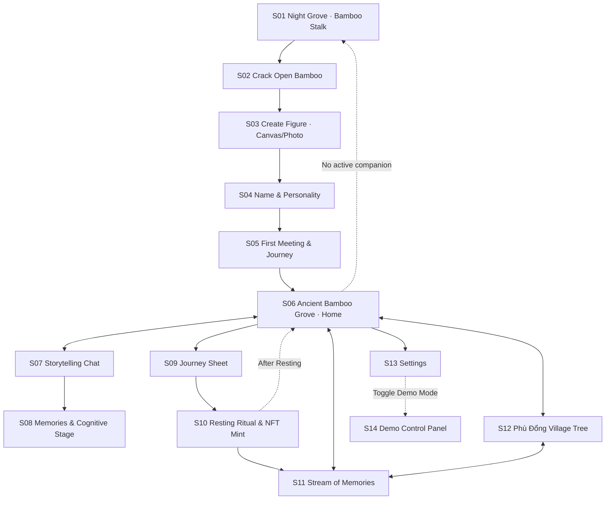

# PROMPT FOR ANTIGRAVITY — Măng Non (Interactive Prototype Specification)

> **User Guide:**
> 1. Place in workspace: `Idea03_MangNon_CoreDesign.md` (lore + art), `Idea03_MangNon_Tonghop.md` (technical architecture), and this file.
> 2. Open Antigravity, select Planning mode, and run the kick-off prompt below.

## Kick-off Prompt

```
Read this document, followed by Idea03_MangNon_CoreDesign.md and Idea03_MangNon_Tonghop.md.
Together, these files define the complete specification for "Măng Non": lore, art direction,
screen maps, user flows, and Avalanche Fuji on-chain contracts.

Build a mobile-first interactive prototype at 390×844 viewport.
Priority order:
1. Warm, non-judgmental, pressure-free atmosphere.
2. Smooth, uninterrupted journey from discovery to the resting ritual.
3. Authentic Vietnamese folk visual identity (Ghibli environmental depth + Đông Hồ woodblock UI).
4. Full Avalanche Fuji testnet contract integration with zero mock fallbacks.
```

---

# SPECIFICATION

## 1. Product Identity

You are building an interactive prototype for **MĂNG NON** — a mobile-first study sanctuary where students and self-learners create a companion from their own hand-drawn artwork, nurturing its understanding of the world simply by **sharing their daily learning journey**.

The prototype is optimized for a **3-minute live presentation before hackathon judges**:
1. **Feeling:** Gentle, intimate, non-judgmental in every microcopy string.
2. **Smooth Flow:** Seamless progression from S01 through S12 without dead ends.
3. **Vietnamese Folk Artistry:** Ghibli atmospheric lighting for the grove; Đông Hồ woodblock linework for UI and artifacts.
4. **Blockchain Integrity:** Real Avalanche Fuji contracts (`GoalRegistry`, `MamLucVault`, `VillageTree`, `JourneyNFT`, `TramTreCheckin`).

---

## 2. Core Principles

**2.1 The Guiding Litmus Test:**
When facing design ambiguity, ask:  
*"Does this make the user feel warmly awaited, or coldly pressured?"*  
If it induces anxiety, redesign it.

**2.2 Priority Order of Truth:**
- World, Companion Persona, Visual Style: `Idea03_MangNon_CoreDesign.md`
- Screens, Flows, Constraints, State: This specification file.
- Technical Architecture & Smart Contracts: `Idea03_MangNon_Tonghop.md`

---

## 3. Product Overview

**Logline:** One quiet night in the bamboo grove, you find a small glowing creature waiting to learn about the world — where every page you study, line of code you write, and quiet hour you focus gently breathes life into a shared tree of knowledge, blossoming into tangible educational scholarships and student support.

**Core Message:** *"Growing up does not happen because someone threatened you with a timer, but because someone is waiting quietly to hear what you learned."*

**Three Guiding Words:** Gentle — Intimate — Non-Judgmental.

### 3.1 Terminology Dictionary

| Term | In-Product Meaning | UI Copy Guidance |
|---|---|---|
| **Măng Non** | A living companion born from the user's sketch, growing cognitively | Never call it "pet", "bot", or "avatar" |
| **Glowing Stalk** | A luminous bamboo stalk that opens once to birth a companion | Warm golden amber light, peak animation |
| **Journey** (Goal) | A learning pursuit or semester milestone chosen by the user | Use "journey", never "task" or "quota" |
| **Focus Session** | Undisturbed 15/25/45m study session with complete silence | Quiet hourglass, no harsh alerts |
| **Show-and-Tell** | Snapping a photo of fresh notes or code to show Măng Non | Proof of Output without surveillance |
| **Student Profile** | Verification via `.edu.vn` for 1.5x Student Boost | Verified badge + 3 exam shields |
| **Study Station** | Partner student study cafe (Highlands, The Coffee House) | GPS check-in unlocking 15–20% drink vouchers |
| **Cognitive Stage** | 4 organic phases: Curiosity → Association → Perspective → Companionship | Rendered as 1–4 glowing leaves, not XP bars |
| **Ancient Bamboo Grove** | Personal sanctuary of the learner (Home screen) | S06 Home Screen |
| **Phù Đổng Village Tree** | Community knowledge canopy and scholarship pool | S12 Village Screen |
| **Stream of Memories** | Where resting companions become eternal river stones | S11 Memorial Screen |
| **Resting Ritual** | Journey completion; Măng Non gives thanks, mints JourneyNFT, and sleeps | Never say "died", "deleted", or "game over" |

---

## 4. User Personas & Use Cases

**Target Learners:** University students and self-directed learners (ages 18–28) who seek deep focus and a calming study atmosphere, but reject coercive habit trackers that punish missed days.

### 4.1 Use Case Matrix

| ID | Use Case | Pass Criteria | Target Emotion |
|---|---|---|---|
| UC01 | First encounter with glowing stalk | Lands directly on S01 (night grove); no pop-ups blocking entry | Wonder, serenity |
| UC02 | Create companion via **hand drawing** | Canvas tool allows ink sketching; outputs transparent paper puppet with gentle organic breathing | Creative pride |
| UC03 | Create companion via **photo/upload** | Automated background cutout preserves original artwork without redrawing | Trust |
| UC04 | Use **sample sketch** | Select 1 of 3 charming handcrafted sketches | Ease, zero friction |
| UC05 | Name, choose trait, first meeting | 3-turn interactive dialogue; optional journey setup | Intimacy, gentle warmth |
| UC06 | Everyday storytelling | Sending a story updates memory; companion reacts organically based on trait | Connectedness |
| UC07 | Review and release memories | Inspect stored thoughts; "Let this fade" releases memory permanently | Sovereignty, peace of mind |
| UC08 | Return after long absence | No guilt trip, no missed streak alerts; companion welcomes user warmly | Comfort of homecoming |
| UC09 | Conclude journey & Resting Ritual | 5-phase peaceful ritual; imprints JourneyNFT on Avalanche Fuji; stone appears in stream | Gentle pride, nostalgia |
| UC10 | Visit Stream of Memories | Touch river stone to view companion silhouette, last words, and Snowtrace TX | Deep reverence |
| UC11 | Visit Phù Đổng Village Tree | Canopy glows with collective focus leaves; bloom event occurs on milestones | Belonging to something larger |
| UC12 | Dynamic clock and season shifts | Morning, dusk, night, and 4 seasons update color palette and sound acoustics | Living, breathing world |
| UC13 | Network loss & graceful fallbacks | Friendly offline fallback messages; no raw crash codes | Reassurance |
| UC14 | Reset data | Two-step confirmation; returns cleanly to S01 | Complete control |
| UC15 | **Quiet Focus & Show-and-Tell** | 15/25/45m timer in absolute silence; snap notes/code; companion reacts with curiosity; awards Mam Luc | Flow state, joyful accomplishment |
| UC16 | **Student Profile & Boost** | Google sign-in + `.edu.vn` verification grants Verified Student badge and 1.5x Mam Luc | Dignity and encouragement |
| UC17 | **Study Station GPS Check-in** | Haversine check-in ($\le$ 300m) at partner cafes unlocks 15–20% voucher and aids scholarship pool | Tangible student support |

---

## 5. Screen Map & Navigation



---

## 6. Screen Specifications

### S01 — Night Grove & Glowing Stalk
- **Purpose:** First impression of the realm. A lone bamboo stalk pulses with amber light.
- **Layout:** 3-layer parallax bamboo grove at night. A golden amber glow emanates from the stalk.
- **Microcopy:** *"A gentle amber glow stirs among the bamboo."* / *"Touch the glowing bamboo stalk."*

### S02 — Crack Open Bamboo
- **Purpose:** Emotional peak. The stalk splits with golden warmth spilling into the night.
- **Motion:** Bamboo vibrations $\rightarrow$ crack fissure $\rightarrow$ warm amber burst $\rightarrow$ tiny firefly particles floating upward.

### S03 — Create Companion (Studio)
- **Purpose:** Bestowing form upon the spirit without AI redrawing.
- **Tools:** 
  - *Draw:* Hand-drawn canvas with 14 folk ink pigments, eraser, undo.
  - *Photo / Upload:* Camera capture with automated client-side background cutout.
  - *Sample Sketches:* 3 handcrafted folk drawings.
- **Preview:** Paper puppet breathes softly with die-cut sticker outline.

### S04 — Name & Personality Trait
- **Traits:** Curious (*Tò mò*), Tranquil (*Điềm tĩnh*), Playful (*Hào hứng*), Shy (*Nhút nhát*).
- Touching each trait triggers unique companion idle kinematics.

### S05 — First Meeting & Journey Setup
- 3-turn scripted warm chat establishing the learning intention (e.g. reading, calculus, language).
- Optional duration chips (*7 days / 14 days / 30 days / I will tell you when I finish*).

### S06 — Ancient Bamboo Grove (Home)
- **Top Bar:** Companion name, cognitive leaf stamp, Student Profile button, Focus Sanctuary button, and Settings.
- **Hanging Slip:** Displays active journey title. Tap to open S09.
- **Centerpiece:** Animated companion standing on the mossy ground. Tap for gentle idle whispers.
- **Bottom CTA:** *"Share a story with Măng Non"* and *"Focus"*.

### S07 — Storytelling Chat
- **Dialogue:** Măng Non speech bubbles styled as coiled bamboo slips; user messages as smooth Dó paper cards.
- **Starter Chips:** *"Today I learned…"*, *"Something stayed on my mind…"*, *"I noticed something curious today…"*.

### S08 — Things Măng Non Remembers
- Displays cognitive stage (1–4 leaves) with poetic descriptions.
- Timeline of stored memories. User can pin to cherish or let fade with gentle confirmation.

### S09 — Journey Sheet
- Displays learning intentions, days shared, and the option to extend or initiate resting.

### S10 — Resting Ritual & On-Chain Imprint
- **5-Phase Sequence:**
  1. Companion expresses heartfelt gratitude.
  2. Looking back at top 3 shared memories.
  3. Parting whisper.
  4. Companion dissolves into light and rests as a river stone.
  5. Imprint onto Avalanche Fuji C-Chain as a permanent JourneyNFT; transfers accrued Mam Luc to the Village Scholarship Pool.

### S11 — Stream of Memories
- Clear stream winding down the screen. Resting companions appear as smooth river stones.
- Tapping a stone opens its memory card, silhouette, last words, and Snowtrace TX verification link.

### S12 — Phù Đổng Village Tree & Scholarship Pool
- The sacred banyan tree glowing with leaves from students nationwide.
- Displays accrued community Mam Luc and matching sponsor contributions for student aid.
- Trigger crimson blossom celebration on milestones.

### S13 — Settings
- Rename companion, gentle reminders (default off), reduced motion toggle, sound toggles, and Demo Mode trigger.

### S14 — Demo Control Panel (3-Minute Tour)
- Comprehensive presentation overlay allowing judges to switch screens, change time/seasons, seed memories, and trigger on-chain events.

---

## 7. Three-Minute Live Demo Script (For Presenters)

1. **0:00–0:30 (Discovery):** Open S01 $\rightarrow$ tap glowing stalk $\rightarrow$ watch S02 golden light animation.
2. **0:30–1:00 (Creation):** Select S03 sketch canvas $\rightarrow$ watch continuous paper puppet deformation $\rightarrow$ S04 select trait (*Curious* or *Playful*).
3. **1:00–1:30 (Student Focus):** S05 setup journey $\rightarrow$ enter S06 $\rightarrow$ tap **Student Profile** to show `.edu.vn` verification and 1.5x Student Boost $\rightarrow$ trigger **Focus Sanctuary** (use the 10-second trial button for judges) $\rightarrow$ complete Show-and-Tell.
4. **1:30–2:00 (Storytelling):** Open S07 $\rightarrow$ share a short thought $\rightarrow$ companion reflects back $\rightarrow$ open S08 to see cognitive stage.
5. **2:00–2:30 (Resting & NFT):** Trigger S10 Resting Ritual $\rightarrow$ view 5-phase ceremony $\rightarrow$ click **Imprint onto Avalanche Fuji** $\rightarrow$ view live Snowtrace verification link $\rightarrow$ view river stone in S11.
6. **2:30–3:00 (Community & B2B):** Visit S12 Phù Đổng Village Tree $\rightarrow$ showcase the Scholarship Pool $\rightarrow$ visit Study Stations to view 20% cafe perks $\rightarrow$ conclude with the core human message.
