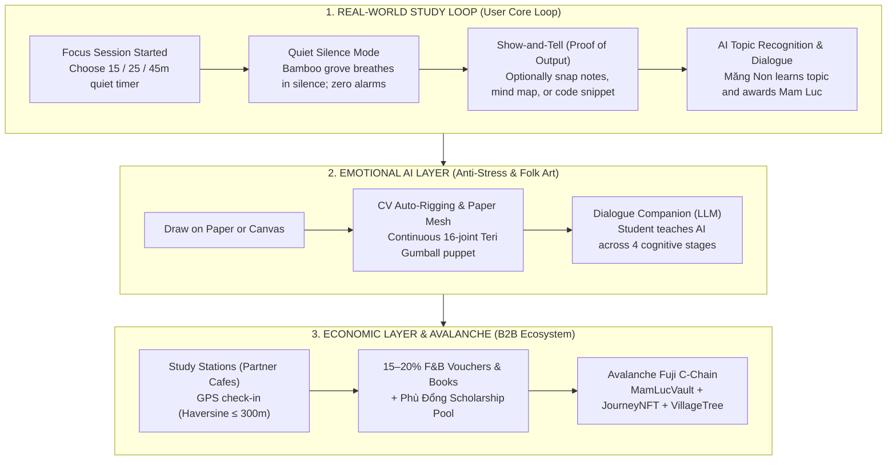

# 🎋 MĂNG NON — FOCUS GARDEN (VƯỜN TRI THỨC)
## Unified Master Architecture & Concept Synthesis

> **1-Sentence Pitch:**
> *An independent learning companion dApp powered by **on-device Computer Vision** and **Avalanche Blockchain**, where every quiet hour of student focus breathes life into a living folk-art paper companion — transforming real notebook notes and code into partner cafe perks, educational courseware, and community scholarships.*

---



---

## 1. Lore & Theme: The Ancient Bamboo Grove & The Tree of Knowledge

- **Setting:** A tranquil realm suspended between memory, folklore, and a quiet study desk. In the village square stands **The Sacred Banyan Tree (Cây Tri Thức)**, currently wilting under modern digital distractions and academic burnout.
- **Player Role:** You are a **Young Scholar** (*Sĩ tử*). Deep in the bamboo grove, you find a luminous bamboo stalk, draw your own companion with folk ink, and help it grow simply by living your life and sharing what you study.
- **Aesthetic:** Studio Ghibli atmospheric lighting (warm amber lantern glow, shifting volumetric light through bamboo) paired with bold Đông Hồ woodblock UI (handcrafted bamboo slips, red cinnabar stamps, and Dó paper cards).

---

## 2. Core Mechanism: "Proof of Output" via Show-and-Tell

Mainstream study apps fail because timers can be left unattended, while intrusive camera surveillance creates severe anxiety. Măng Non solves this with **user-initiated Show-and-Tell**:

```
[Start Session] ──> [Quiet Silence Mode] ──> [Show-and-Tell (Active 100%)] ──> [AI Dialogue Reflection]
  No pressure        Zero camera snaps         Snap photo of notes or code       Companion reflects topic
  Choose 15/25/45m   No tab surveillance       Or click [Skip] freely            Awards Mam Luc to Tree
```

1. **Step 1 — Start Session (Silence Mode):**
   Choose 15, 25, or 45 minutes (or 10 seconds for judge trials). The grove falls silent. No notifications, no penalties for checking references, no browser tab spying.
2. **Step 2 — Pure Focus Flow:**
   Măng Non sits quietly in meditative repose. Deep focus flows undisturbed.
3. **Step 3 — Show-and-Tell (Active 100% User Opt-In):**
   When the timer concludes peacefully, you can snap a photo of your notebook or code snippet.
   - **Clicking `[Skip]` is always available:** If you read physical books, sketched paper wireframes, or simply prefer not to photograph, tapping `[Skip]` still completes the session and awards Mam Luc.
4. **Step 4 — AI Topic Recognition & Companion Reflection:**
   AI Computer Vision and NLP inspect the photo and short note, identifying the study domain (Calculus, React Code, English Vocabulary, Macroeconomics):
   - **Curious Companion:** *"Oh wow! You just finished this? These lines look so curious and magical, thank you for showing me!"*
   - **Tranquil Companion:** *"These quiet hours are truly precious. Every stroke of your pen breathes new life into the grove."*
   - **Playful Companion:** *"Brilliant effort, my friend!! That was such a fruitful focus session, I am beaming with joy for you!"*
   - **Shy Companion:** *"...You worked so diligently today. Seeing your quiet patience gives me courage too..."*

---

## 3. Student System & Sustainable Rhythms

### 3.1 Student Verification (`.edu.vn` / Student ID)
- **1-Click Google Sign-In with Embedded Avalanche Wallet:** Generates a deterministic Avalanche Fuji address directly from the user's account without requiring seed phrases.
- **University Email Verification (`.edu.vn`):** Automated verification granting the permanent **"Verified Student"** badge.
- **Student Privileges:**
  - **Student Boost:** 1.5x Mam Luc multiplier on all completed study sessions.
  - **Exam Sanctuary (3 Shields/Month):** Protects the companion from interruptions during stressful midterm or finals weeks.
  - **Study Station Perks:** 15%–20% off drinks at partner cafes around campus.

### 3.2 Non-Violent Progression (Zero Streak Shame)
No threatening red streak counters. Instead, learning dedication is reflected through gentle milestones:
- **Apprentice Reader:** Unlocks shared communal study rooms.
- **Distinguished Scholar:** Unlocks textbook grants and educational courseware vouchers.
- **Honorary Valedictorian:** Imprints an exclusive Soulbound **JourneyNFT** on Avalanche Fuji upon concluding the study journey.

---

## 4. Emotional AI Layer: "Breathe Life Into Paper"

- **"Fish Swimming in the Pond" Mechanics:** Users draw on physical paper or the built-in canvas $\rightarrow$ AI removes the background, generates a Dó paper sticker outline, articulates 16 anatomical joints, and applies organic continuous paper puppet physics.
- **Inverted Role — Student Teaches AI:** You are not tested or graded. Măng Non grows through what you explain:
  - *Stage 1 (Raw Curiosity):* Asks naive, fundamental questions.
  - *Stage 2 (Association):* Connects ideas you shared across different days.
  - *Stage 3 (Personal Perspective):* Expresses gentle aesthetic preferences and playful banter.
  - *Stage 4 (Deep Companionship):* Offers quiet emotional presence and comforting companionship.

---

## 5. B2B Win-Win-Win Ecosystem & Avalanche DeFi Architecture

$$\begin{aligned}
\textbf{Students:} & \quad \text{Flow-state study} + \text{15–20\% cafe discounts} + \text{Permanent graduation NFT} \\
\textbf{Study Cafes (Study Stations):} & \quad \text{Steady student foot traffic during off-peak hours} + \text{GPS verified customers} \\
\textbf{Corporate CSR / Bookstores:} & \quad \text{Transparent on-chain scholarship funding} + \text{Authentic cultural engagement}
\end{aligned}$$

1. **Study Stations (Partner Cafes & Campus Libraries):**
   Students visit partner cafes (Highlands, The Coffee House, Cheese Coffee) and perform a privacy-preserving GPS check-in (Haversine radius $\le 300\text{m}$) $\rightarrow$ Unlocks 15–20% drink vouchers and doubles Mam Luc.
2. **Mam Luc Vault (`MamLucVault.sol` — ERC-4626):**
   Students stake a small testnet commitment deposit. Upon completing their journey, they withdraw **100% of their principal**. Accrued mock-yield automatically feeds the **Phù Đổng Student Scholarship Pool**.
3. **Corporate CSR & Book Grants (Fahasa / EdTech):**
   Educational sponsors match pooled community Mam Luc to provide real-world textbook care packages and scholarship grants.
4. **Strict Legal Compliance (Zero Real-Money Gambling):**
   In-game points and Mam Luc **CANNOT be cashed out directly**. All value is strictly channeled into commercial service discounts (cafe drinks, book vouchers) and audited non-profit student scholarships, eliminating any regulatory or gambling risks.

---

## 6. Deployed Smart Contracts & Technical Infrastructure

All 5 contracts are deployed live on **Avalanche Fuji C-Chain (Chain ID: `43113`)**:

| Contract | Fuji Address | Role |
|---|---|---|
| **`VillageTree`** | `0x372587d6BF5B3c3a2D267df6a22f87E3F9ebb0AA` | Manages community leaves and the Phù Đổng Scholarship Pool |
| **`GoalRegistry`** | `0x814C3450FC4ddF562411a8C820710E0D100C3264` | Registers study goals and companion attributes |
| **`MamLucVault`** | `0x7e342d6b338ecb2D1F2ed609b4554b7b1A8cBdC0` | ERC-4626 commitment vault with 100% principal refund |
| **`JourneyNFT`** | `0x7Db4Be38e24A710476916B4e576BD12c2e603a4E` | Soulbound graduation NFT containing artwork hash and last words |
| **`TramTreCheckin`** | `0xAe9E327A569146e2d59F2Fa4b4749f3060591Da1` | Cryptographic GPS verification issuing single-use vouchers |

---

## 7. The Winning Formula for Hackathon Judges

1. **Photo Capture:** **100% User-Initiated (Show & Tell)** with a clear `[Skip]` option — zero surprise webcam snapping, zero intrusive surveillance.
2. **AI Verification:** Computer Vision & NLP identify the study subject (Math, Code, Languages) $\rightarrow$ initiates a curious dialogue so Măng Non learns with the student.
3. **Rewards:** **Cafe Vouchers + Book Packs + Community Scholarships** — strictly compliant with Vietnamese and Web3 hackathon anti-gambling regulations.
