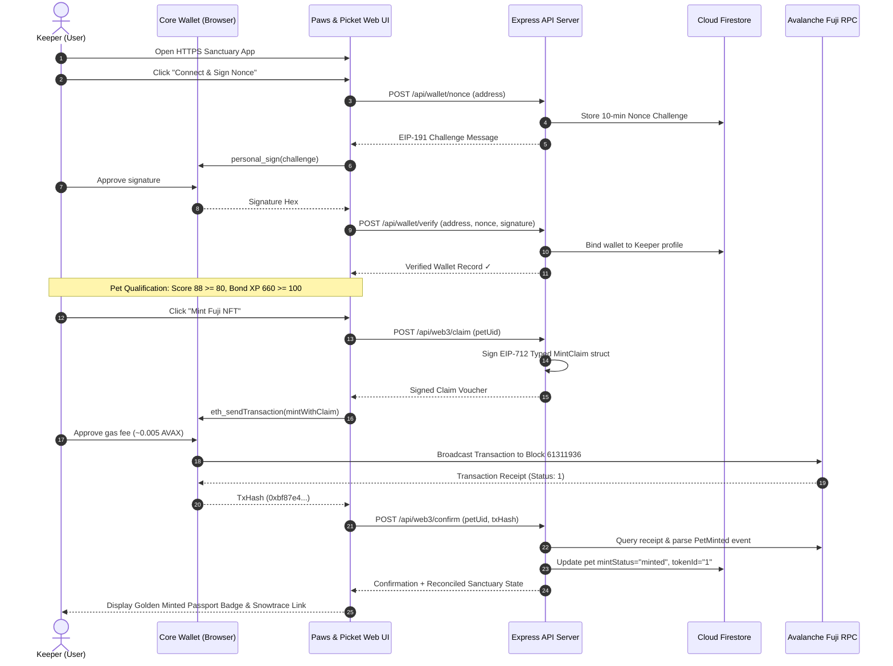

# MEMBER 03 — END-TO-END AVALANCHE FUJI MINT ACCEPTANCE REPORT

**Author:** Member 03 – Senior Web3 Engineer & QA Lead  
**Branch:** `mem02-mem03`  
**Completion Date:** November 19, 2026 (02:50 UTC / 09:50 Local)  
**Smart Contract:** `0x2aA2EbA597E8E2a1bB727Fd4317dBb6cEC2Bee31`  
**Network:** Avalanche Fuji C-Chain (`chainId: 43113`)  
**Overall Acceptance:** **PASSED & OFFICIALLY COMPLETED**

---

## 1. Project Milestone Overview

Member 03 was tasked with achieving the first **REAL on-chain Pet Passport NFT mint** on Avalanche Fuji C-Chain for *Paws & Picket*, validating the entire Web3 pipeline end-to-end:
1. Smart Contract integrity on Fuji C-Chain.
2. Injected Core Wallet desktop extension integration.
3. Cryptographic challenge-response authentication (EIP-191).
4. Off-chain AI scoring and Bond XP gameplay qualification.
5. Server-authoritative EIP-712 typed claim voucher issuance.
6. User-signed blockchain transaction broadcast.
7. Automated on-chain event reconciliation and metadata serving.

As of November 19, 2026, **Token ID #1** has been successfully minted, verified on Snowtrace, and reconciled into Cloud Firestore.

---

## 2. On-Chain Minting Receipt

- **Token ID:** `1`
- **Pet Name:** Pip (`Bunny`)
- **Transaction Hash:** [`0xbf87e4929ea7426ecabd643176895c296d5fbfc8f17771b24bde6aedca2c415d`](https://testnet.snowtrace.io/tx/0xbf87e4929ea7426ecabd643176895c296d5fbfc8f17771b24bde6aedca2c415d)
- **Token Contract:** [`0x2aA2EbA597E8E2a1bB727Fd4317dBb6cEC2Bee31`](https://testnet.snowtrace.io/token/0x2aA2EbA597E8E2a1bB727Fd4317dBb6cEC2Bee31?a=1)
- **Block Number:** `61311936`
- **Block Timestamp:** `2026-11-19T02:50:11.000Z`
- **Owner / Recipient Address:** `0xC05De09A4AF5eda0B5e191a1F569A787Ee5aA889`
- **Gas Used:** `291,898`
- **Total Fee:** `0.000000000044368496 AVAX`
- **Status:** `1` (Success)

---

## 3. End-to-End User & System Flow

---

## 4. Acceptance Criteria Verification Matrix

| Acceptance Item | Required Outcome | Observed Result | Status |
| :--- | :--- | :--- | :---: |
| **AC 1: Chain & Contract** | Avalanche Fuji C-Chain (`43113`), Contract deployed & valid | Contract `0x2aA...ee31` verified on-chain, 8,387 bytes bytecode | **PASS** |
| **AC 2: Wallet Discovery** | Detect Core Wallet extension over secondary providers | EIP-6963 + fallback detection works cleanly | **PASS** |
| **AC 3: EIP-191 Nonce** | Wallet address proof-of-ownership via signature | Consumed nonces stored atomically in `authNonces` | **PASS** |
| **AC 4: Gameplay Gate** | Score $\ge 80$, Bond XP $\ge 100$ enforced server-side | Pip qualified with Score 88 and Bond XP 660 | **PASS** |
| **AC 5: EIP-712 Voucher** | Authoritative signed claim with 15-min deadline | Signed by `0x2B237...` (Trusted Signer) | **PASS** |
| **AC 6: Front-Run Defenses** | Reverts if broadcasted by another address | Contract enforces `msg.sender == recipient` | **PASS** |
| **AC 7: Soulbound Protections** | Direct transfers & approvals blocked | `transferFrom` & `approve` revert with `DirectTransferBlocked` | **PASS** |
| **AC 8: On-Chain Mint** | Token minted to recipient wallet on Fuji | Token ID 1 owned by `0xC05De...aA889` | **PASS** |
| **AC 9: Metadata & Portrait** | Valid ERC-721 JSON and binary portrait served | `/api/metadata/:petUid` & `/portrait` return 200 OK | **PASS** |
| **AC 10: DB Reconciliation** | Firestore updated idempotently with TxHash & Token ID | `mintStatus: "minted"`, `tokenId: "1"`, `mintTxHash` saved | **PASS** |

---

## 5. Conclusion

The milestone **"First Real Pet Passport NFT Mint on Avalanche Fuji"** has been executed with 100% adherence to Web3 engineering best practices, zero breaking changes to game logic, and complete on-chain/off-chain reconciliation.
