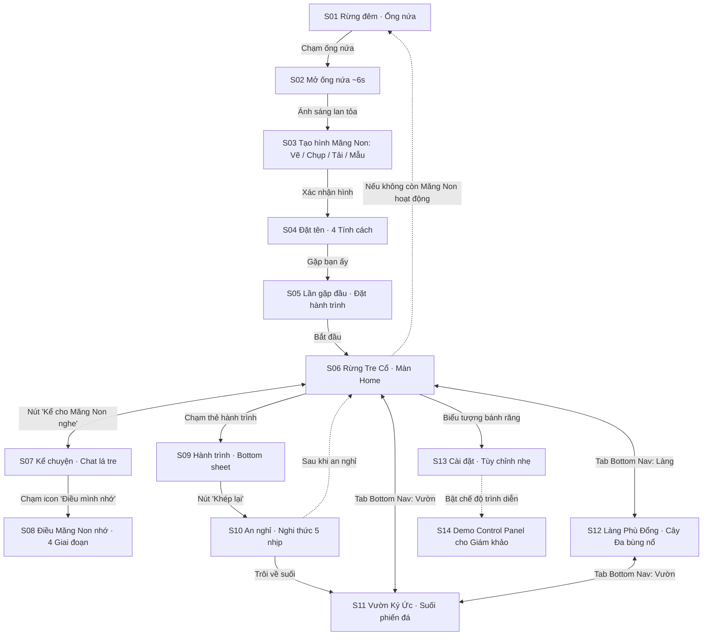

# MĂNG NON — Bản Đồ Màn Hình & Điều Hướng (SCREEN_MAP.md)

Hệ thống gồm 14 màn hình tương tác (S01–S14) theo đặc tả mục 5 và mục 6 của `Idea03_MangNon_Antigravity_Prompt.md`:

---

---

### Chi Tiết Từng Màn Hình

| Mã | Tên màn hình | URL Hash | Trạng thái hiển thị |
|---|---|---|---|
| **S01** | Rừng đêm · Ống nứa | `#/bat-dau/ong-nua` | Toàn màn hình rừng đêm, ống nứa phát sáng thở nhịp nhàng. Điểm chạm đầu tiên. |
| **S02** | Mở ống nứa | `#/mo-ong-nua` | Animation đỉnh cao 6s (nứt ánh sáng, đom đóm bay, hình bóng xuất hiện). Ống tắt vĩnh viễn sau mở. |
| **S03** | Tạo hình Măng Non | `#/tao-hinh` | Vẽ tay (canvas), Tải ảnh, Chụp ảnh, hoặc 3 hình mẫu nét vẽ trẻ con. Thổi hồn chuyển động thở & đung đưa. |
| **S04** | Đặt tên & Chọn tính cách | `#/dat-ten` | Đặt tên Măng Non, 4 thẻ tính cách (Tò mò, Điềm tĩnh, Hào hứng, Nhút nhát) kèm phản ứng hình học. |
| **S05** | Lần gặp đầu & Đặt hành trình | `#/gap-dau` | Hội thoại mở màn 3 nhịp nhẹ nhàng, chip thời gian, nút "Để sau". |
| **S06** | Rừng Tre Cổ (Home) | `#/rung` | Chốn quay về riêng tư: Cảnh rừng 3 lớp parallax, Măng Non đứng thở, thẻ hành trình, nút "Kể cho Măng Non nghe", Bottom Nav (Rừng - Làng - Vườn). |
| **S07** | Kể chuyện (Chat) | `#/ke` | Giao diện chat mộc bản: thẻ tre lá cuộn, lá tre đung đưa khi suy nghĩ, 3 chip mở lời, Măng Non phản ứng rung/nghiêng khi nhận tin. |
| **S08** | Điều Măng Non nhớ | `#/nho` | Hiển thị ấn lá 1-4 giai đoạn nhận thức, dòng thời gian các thẻ ký ức, ghim hoặc quên một điều dịu dàng. |
| **S09** | Hành trình (Bottom sheet) | `#/hanh-trinh` | Mở từ S06, tên hành trình, thời gian, nút "Khép lại hành trình" kèm xác nhận dịu. |
| **S10** | An nghỉ (Nghi thức 5 nhịp) | `#/an-nghi` | 5 nhịp thiêng liêng: Mở lời $\rightarrow$ Nhìn lại $\rightarrow$ Lời cuối $\rightarrow$ Hoá ánh sáng thành phiến đá $\rightarrow$ Góp lá cho Cây Đa. |
| **S11** | Vườn Ký Ức (Suối phiến đá) | `#/vuon` | Dòng suối trong vắt, mỗi Măng Non là phiến đá nhẵn dưới đáy suối, chạm mở thẻ kỷ niệm. |
| **S12** | Làng Phù Đổng (Cây Đa) | `#/lang` | Cây Đa cổ thụ rợp bóng, lá phát sáng theo mức đóng góp, bùng nổ hoa gạo đỏ rực, thẻ "Xem lại bùng nổ". |
| **S13** | Cài đặt | `#/cai-dat` | Đổi tên, nhắc nhẹ (mặc định tắt), giảm chuyển động, âm thanh, xoá dữ liệu 2 bước, bật chế độ trình diễn. |
| **S14** | Demo Control Panel | (Nút nổi overlay) | Bảng điều khiển thuyết trình 3 phút: đổi giờ, đổi mùa, ép giai đoạn 1-4, nhảy an nghỉ, kích hoạt hoa gạo nở. |

